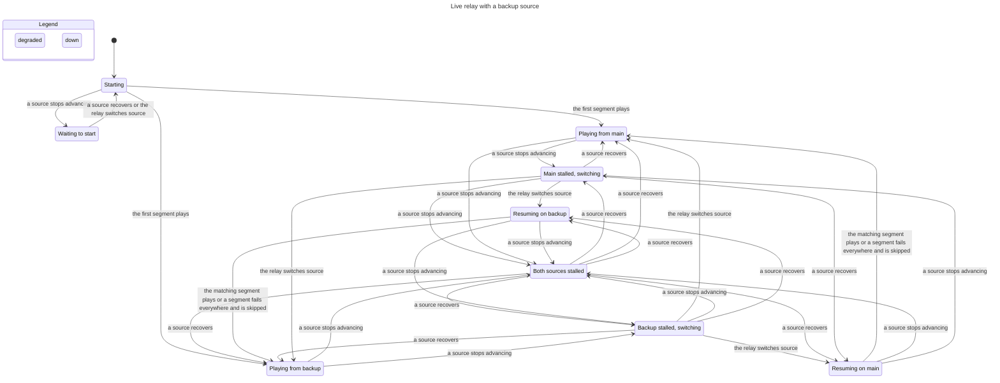
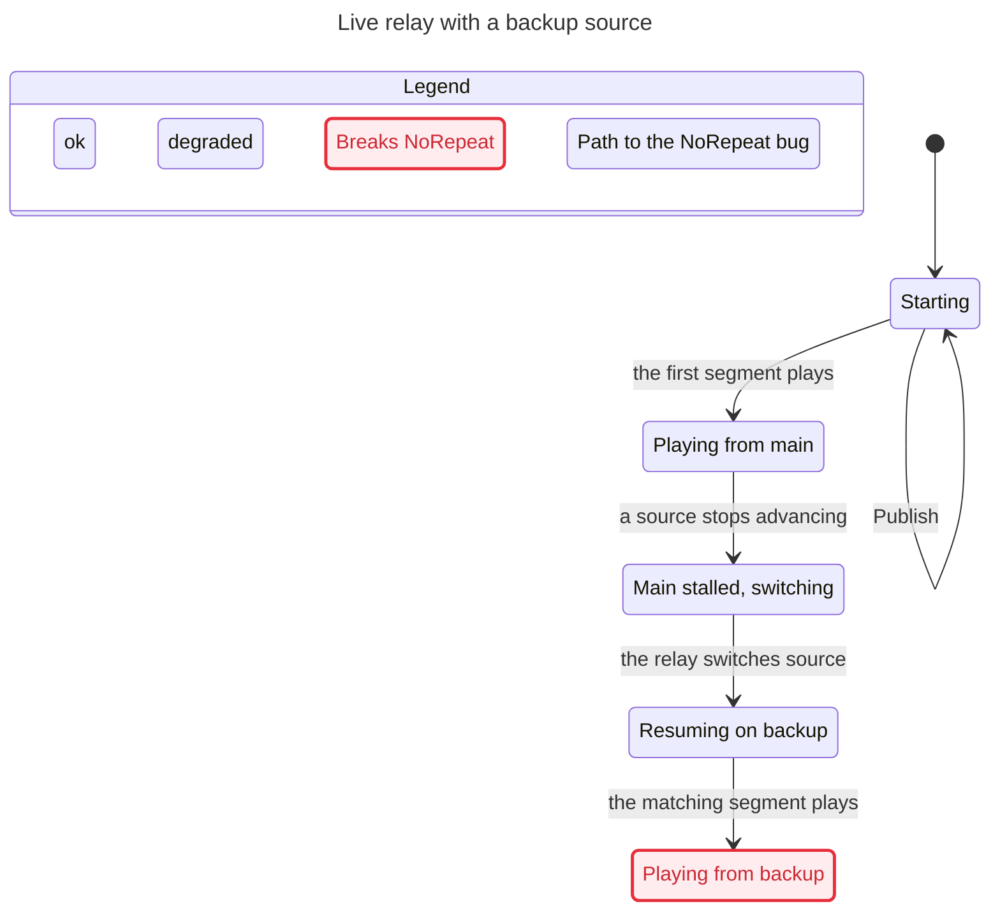

# Live relay failover

When live playback has a backup source, `sportscli/relay.py` (class `Merged`) switches
between the two sources and `sportscli/merge.py` (class `Timeline`) decides which segment
to play next. The promise: **the player never sees a moment of the game twice, never
goes back, and only jumps ahead past a segment that no source could supply.**

`verification/relay/RelayFailover.tla` models that in TLA+ and `verification/relay/check.sh`
model-checks it (TLC, every order of segments published, sources failing and recovering,
switches and skips, up to 6 segments with the backup one segment behind).

| Sources share | Verdict |
|---|---|
| Video timestamps (same encoder) | Holds: the relay realigns to the next moment or waits |
| Segment names | **Can repeat** when the backup has not yet published the segment that was playing |
| Program dates | **Can repeat** when the backup has not yet published the next moment |
| Nothing | Can repeat or skip ahead |

The repeats come from one fallback: when the new source has not published the matching
segment yet, `Timeline.plan()` keeps the same distance from the live edge instead of
waiting. `tests/test_relay_model.py` replays these paths on the real code.

## How the relay moves between states

Rendered from the model with 4 segments; every rule holds when sources share video timestamps.

## The repeat, as a path

With shared segment names and a backup one segment behind: play from main, main stalls,
switch, and the backup's newest segment is the one already played.

