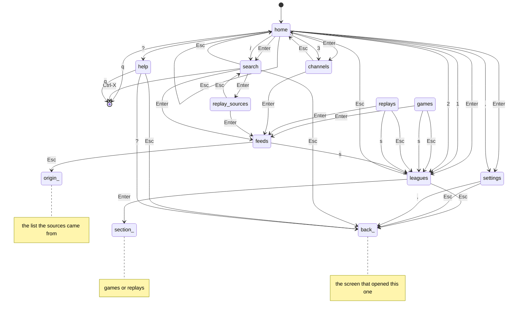

# Screens

The app opens on Home: live sports, replays, live TV, search and settings. Keys mean the
same thing on every screen:

| Key | Does |
|---|---|
| `1` `2` `3` | Live sports, replays, live TV |
| `/` | Search teams, players, games and channels |
| `,` | Settings |
| Enter, → or `l` | Open or play |
| Esc, ←, `h` or Backspace | Back up one level |
| `s` | Change sport (schedules, replays and their sources) |
| `f` | Filter the current list |
| `r` | Refresh the current list |
| `?` · `q` | Help · quit |
| `a` | Home or away feed (live game sources) |

Pressing `?` or `,` on its own screen closes it, and `1` or `2` inside that section changes sport.
Any other key that does nothing on a screen says so on the status line.

The statechart lives in `sportscli/screens.py`. `tests/test_screens.py` explores every
reachable screen state with every key (offline, with sample games, replays and channels)
and checks that:

- every move between screens is one the chart allows, and every chart move happens;
- Esc, repeated, always leads back to Home;
- help and search return to the screen they were opened from;
- `/`, `1`, `2`, `3` and `,` lead to the same place from every screen, and `s` only ever changes sport;
- `q` (Ctrl-X in search) quits from every screen;
- every key shown in a screen's footer does something there, in every league.

Change the chart in the same commit as the key handling in `App.handle_key`. The diagram
leaves out the global keys except from Home, since every screen has them.

