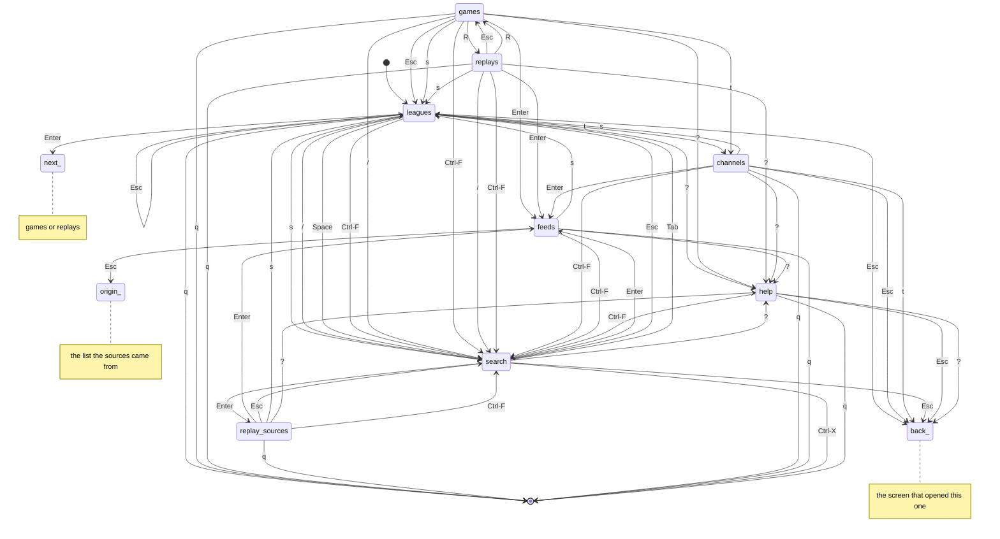

# Screens

The app's screens and keys form the statechart in `sportscli/screens.py`.
`tests/test_screens.py` explores every reachable screen state with every key
(offline, with sample games, replays and channels) and checks that:

- every move between screens is one the chart allows, and every chart move happens;
- Esc, repeated, always leads back to the sports list;
- help and search always return to the screen they were opened from;
- `q` (Ctrl-X in search) quits from every screen;
- every key shown in a screen's footer does something there.

Change the chart in the same commit as the key handling in `App.handle_key`.

